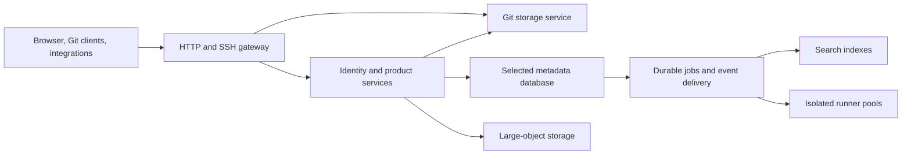

# Deployment and failure contract

Status: architecture requirements for the foundation experiments. An experimental M1 server/development Compose setup exists; no production installer or distributed service is implemented.

## One product, different placement

On one machine, compatible application roles can run together; the database remains a managed separate process. CI execution is isolated even when it shares a physical host. In a cluster, application roles can run separately and scale independently, while the data services gain their qualified redundancy configurations.

This diagram describes ownership and data flow, not mandatory network hops. In-process implementations may avoid serialization, but must preserve the same command semantics, error meanings, authorization, and idempotency contracts as remote implementations.

## Topology targets

| Profile | Purpose | Data behavior |
| --- | --- | --- |
| Personal/team single host | Simple setup with all implemented product features | Durable local commits; one host is one failure domain |
| Single-region distributed | Higher capacity and tolerance of one qualified node failure | Replicated metadata, Git, and large objects; redundant ingress and application roles |
| Regional disaster recovery | Later extension | Explicit replication lag and restore/promotion procedures |
| Multiple write regions | Future decision | Requires a separate latency, consistency, routing, and conflict model |

A feature may require resources or an external runner without becoming a paid feature tier. A small installation is not required to host a public compute fleet. AI assistance and remote development remain optional future modules.

## Failure vocabulary

- **Rejected:** the service knows the operation did not commit and reports that outcome.
- **Committed:** the operation passed the configured durable-commit boundary.
- **Unknown:** the connection failed or deadline expired before the caller learned the result. The caller queries/retries the same operation ID.
- **Unavailable:** the service cannot establish the required consistency or durability and refuses new writes.
- **Data loss:** an acknowledged commit cannot be recovered. This must be distinguished from temporary unavailability.

The distributed target is no acknowledged-write loss within a specified one-node failure model, with truthful failure/timeout behavior. It is not a promise against every combination of correlated disk failure, operator error, faulty storage hardware, software corruption, or whole-region loss.

## Candidate-specific metadata qualification

PostgreSQL qualification must include synchronous replication, a tested failover manager, primary fencing, suitable promotion candidates, and reconnection behavior. Replication alone does not solve split brain. If the manager cannot establish safe promotion, it must stop writes rather than promote an arbitrary lagging replica.

FoundationDB qualification must use an explicitly chosen redundancy configuration and independent failure-domain placement. Coordinator/process counts and actual data redundancy are separate properties. Four processes on the current workstation remain one failure domain.

Compare the two candidates against the same external goal: the same logical transactions, one-node failure tolerance, durable acknowledgements, and declared recovery behavior. Their internal replication algorithms need not be identical. Record all resource totals and network latency.

## Git writes and merges

The Git service is the only authority allowed to change repository refs in a product deployment. Product workers submit intents; they do not write directly to repository directories.

A future push protocol must validate and durably place required objects before publishing committed refs. A three-voter Git group is a proposed configuration, not an implemented guarantee. Its log, object durability, membership changes, snapshots, garbage collection, and read consistency need one coherent design.

A merge intent identifies the repository, source object ID, expected target object ID, merge method, candidate result, policy generation, and operation ID. The final branch mutation must compare against the expected target and reject stale work. Checks and approvals must bind to the relevant candidate and policy version. A stale candidate is recomputed and revalidated; a retry cannot silently merge different code.

Metadata status may temporarily lag the committed Git result. A reconciler reads the authoritative operation result and repairs that status. There is no implied atomic transaction across the metadata database and Git journal. The UI must distinguish an in-progress/unknown result from a confirmed failure.

## Expansion without replacing the product

The future installer/admin tool should support this controlled sequence:

1. Inventory versions, storage health, available capacity, certificates, and backups.
2. Establish independent database and Git replicas using their supported replication/bootstrap procedures.
3. Verify catch-up, permissions, and durable recovery before counting replicas as healthy.
4. Add application roles, initially routing limited work to them.
5. Migrate large objects to the selected distributed backend with checksums and an explicit read/write cutover.
6. Change repository placement through versioned routing, write fencing, and a resumable migration record.
7. Run failure tests before advertising the distributed availability profile.

Preserve tenant/repository identities, client URLs, API contracts, and export semantics. Same product does not mean that copying a data directory while writers are active is a supported migration.

## Recovery and upgrade requirements

Backups cover metadata, Git refs and reachable objects, large objects, configuration, and the keys needed to decrypt or verify them. Search indexes may be rebuilt. A successful backup job is not enough: restore into a fresh installation and verify relationships, permissions, representative clones, and object integrity.

Upgrades need a supported version window, expand/contract metadata migrations, durable-format compatibility checks, and a tested roll-forward or restore route. Downgrading a binary is not automatically a valid rollback after a data migration.

Until those procedures are implemented and tested, the repository provides experiments and contracts, not an HA product or an installation sizing guarantee.
