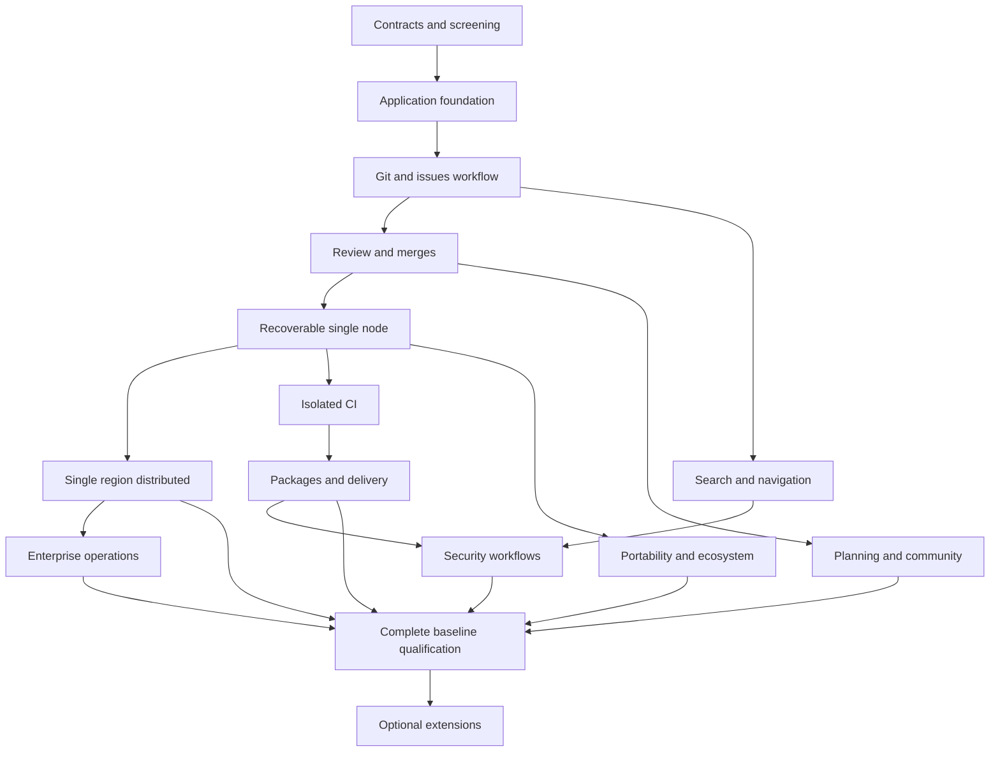

# Full forge implementation roadmap

Baseline: 2026-10-27. This plan covers one freely usable forge, from personal hosting to a qualified single-region deployment with a 100,000-account workload profile. It describes intended work, not delivered capability or a calendar promise.

## Product endpoint and architecture

The complete baseline supports planning, source hosting, review, safe merging, isolated automation, packages/releases/sites, deployment workflows, discovery, security, enterprise administration, integration, migration and recovery. Required capabilities are tracked in [the inventory](06-capability-inventory.md). Completion requires implementation and qualification evidence for every required row. Compatibility with other products uses explicit versioned matrices; exact parity with every changing vendor feature is not a finite acceptance criterion.

AI, remote workspaces, federation, managed hosting and multi-region writes are optional/later modules. Self-hosting requires no vendor account, paid feature unlock or public runner fleet. Production use needs a commercial license under [the Business Source License](../../LICENSE), which unlocks no separate features.

Architectural rules:

- PostgreSQL is provisionally selected; FoundationDB remains experimental. Support one primary engine until evidence warrants reopening ADR 0001.
- Stable tenant, account, repository and operation IDs survive renames, restarts and placement changes.
- Domain changes, audit records, idempotency outcomes and outbox records share a metadata transaction where appropriate. External delivery is at least once; consumers deduplicate.
- Git owns objects and authoritative refs. Metadata and Git use durable intents and reconciliation, with no implied cross-system atomic commit.
- New admission checks permissions. Caches, search hits, replicas and content digests do not confer access.
- Single-node and distributed modes share domain code, APIs, formats, configuration schema, features and release train. Placement and durability profiles differ.
- Native Git is the initial wire-protocol baseline. Replace operations with gitoxide only after conformance, correctness and throughput evidence.
- Stable features include UI/API behavior, permissions, export/restore, diagnostics, operator documentation and appropriate tests.
- Optimize measured bottlenecks. Rust, custom scheduling, avoiding subprocesses and io_uring establish no performance advantage by themselves.

## Sequence and dependencies

| ID | Outcome | Dependencies | State |
| --- | --- | --- | --- |
| M0 | Contracts, local Git prototype, metadata screening | None | Screening complete; production qualification open |
| M1 | Server, identity, tenant/database foundation | M0 provisional selection | Verified experimental |
| M2 | Usable Git and issues workflow | M1 | Planned |
| M3 | Reviews and safe merge coordination | M2 | Planned |
| M4 | Recoverable single-node alpha | M2, M3 | Planned |
| M5 | Single-region distributed foundation | M4 | Planned |
| M6 | Isolated CI and workflow compatibility | M3, M4; cluster tests use M5 | Planned |
| M7 | Packages, releases, sites and delivery | M6 | Planned |
| M8 | Planning, documentation and community | M3, M4 | Planned |
| M9 | Search and navigation | M2; cluster indexing uses M5 | Planned |
| M10 | Application/supply-chain security | M6, M7, M9 | Planned |
| M11 | Enterprise identity, policy and operations | M5; integrates M6–M10 | Planned |
| M12 | Portability and integration ecosystem | M4; qualification covers M5–M11 | Planned |
| M13 | Complete baseline qualification/stable release | M5–M12 | Planned |
| M14 | Optional extensions and regional evolution | Separate module decisions | Deferred |

Dependencies are release gates. Independent work may proceed after its contracts stabilize. Reestimate the next two milestones after each gate using actual engineering time. Full-forge calendar dates are intentionally uncommitted.

The table is the authoritative dependency list; arrows summarize major work streams.

## M0 — Contracts and evidence

Delivered: local native-Git reader, stable identifier tests, metadata workload/dataset contract, repeated PostgreSQL/FoundationDB screening, raw results and provisional PostgreSQL ADR.

Open: Rust adapter confirmation, richer permissions/jobs, sustained open-loop load, fresh restore and independent-node failure tests. These remain later qualification blockers. Loading 100,000 accounts establishes dataset evidence, not active-user capacity.

## M1 — Application foundation

Build the executable server, validated configuration, PostgreSQL migrations, bounded resources, structured logs, live/ready probes, protected first-admin bootstrap, login, expiring revocable bearer sessions and organizations with membership isolation. Organization creation, owner membership, audit and outbox commit atomically.

Deliver container/Compose development setup, sample configuration, real PostgreSQL contract tests and exact runbook commands. [M1 specification](05-first-milestone.md) defines acceptance. Exit: reviewer verifies every required criterion, records evidence and preserves existing Git tests. The result is an experimental API foundation.

## M2 — First usable workflow

Build repository create/list/read/rename/archive/delete, namespace uniqueness, visibility/roles, authenticated smart HTTP clone/fetch/push, process/stream bounds, object-format handling, files/trees/commits/diffs, basic issues/comments, accessible server-rendered UI, pagination and idempotency. SSH follows before M4 source-hosting qualification.

Before exposing push, resolve its single-node transaction: quarantine, validation, durable object placement, expected-ref update, journal result, acknowledgement and crash reconciliation. Cover multi-ref updates, force pushes, deletion, tags, large packs and interruption. Git streams require separate budgets from JSON requests.

Exit: clean installation, login, private repository creation, real push/clone, browsing, issue/comment, denial to an unrelated user, restart and fresh restore preserving Git and metadata relationships. Fault injection at write boundaries produces recoverable outcomes without duplicate comments/events.

Measure equivalent local workflows against GitLab, Gitea and Forgejo when available. Record versions, whole-installation resources, datasets, durability, endpoint behavior, latency and failures. Metadata ops/sec cannot be compared directly with whole-platform HTTP requests/sec; unrelated GitHub.com statistics establish no speed ratio.

## M3 — Reviews and safe merges

Build pull/merge requests, comparisons, threaded inline reviews, suggestions, approvals/change requests, drafts, reviewers/code owners, checks, branch/tag protection, signed-commit policy, merge methods, conflicts, merge queue and auto-merge.

Merge intents bind source/target OIDs, candidate result, checks/approvals, policy generation and operation ID. Git uses expected-target mutation; duplicate workers reuse the outcome. Changed tips, permissions and policies require revalidation. Define fork contributions and stale approvals/checks.

Exit: concurrent merges cannot overwrite accepted history; stale checks cannot authorize different code; lost metadata response after a Git commit reconciles; duplicate delivery cannot merge twice; revocation races obey documented admission semantics. UI/API exercise supported merge methods, conflict handling and queue cancellation.

## M4 — Recoverable single-node alpha

Build one setup/admin command, preflight checks, generated secrets, TLS ingress, directory ownership, version/schema checks, diagnostics, quotas, local object storage, durable jobs/outbox delivery, notifications, backup/export, fresh restore and upgrades. PostgreSQL remains separate; CI remains isolated.

Define consistent backup across metadata, Git journals/objects and large objects. A maintenance window is acceptable initially; online backup needs verified snapshot/watermark semantics. Preserve configuration and required encryption keys. Search indexes are rebuildable.

Exit: an independent user installs from the runbook on clean Linux; restart, disk-full behavior, bounded resources, off-host backup, fresh restore, upgrade and controlled uninstall pass. HTTP/SSH authorization agrees. Publish minimum hardware only after measurement. Resolve license files/notices before external distribution; review TLS/session defaults and accessibility.

## M5 — Single-region distributed foundation

Build versioned placement/routing, storage RPC, consensus-based repository journal, membership, durable object replication/catch-up, snapshots, fencing, leader changes, repair, shard moves, distributed large objects, redundant gateways/workers and PostgreSQL HA.

Metadata HA requires synchronous durable acknowledgement, qualified failover manager, safe promotion, fencing, WAL/backup retention and connection recovery. Read replicas do not scale writes. Introduce tenant write sharding only after measuring a limit; first specify catalog availability, oversized tenants, global identities, cross-tenant queries and resumable migration.

Git log commitment and object durability are one protocol: acknowledged refs retain an object recovery path. GC accounts for intents, replicas, journals/snapshots, transfers and backup retention. Specify follower-read consistency and routing-generation behavior.

Exit: on independent failure domains, one supported node loss loses no acknowledged writes; partitions/fencing prevent conflicting writers; missing quorum stops writes; interrupted membership/placement changes recover; replicas rebuild and external backup restores. Expand single-node without changing IDs/URLs/features. Publish exact topology, network/resource costs and recovery bounds. Correlated failures outside the model are documented.

## M6 — Isolated CI

Build versioned YAML, event filters, DAG/matrix/expressions, reusable workflows/actions, checks/status, schedules/manual runs, variables/secrets, logs/artifacts, caches, cancellation, deadlines, concurrency groups, retries, quotas and runner enrollment/revocation.

Fenced job leases reject stale completion. Evaluate Firecracker for untrusted Linux/KVM execution and provide remote runners when local isolation is unavailable. Container actions run inside the supported isolation boundary. Choose scheduler implementation from churn/correctness/recovery evidence.

Define fork/untrusted secret policy, network/egress rules, credential scope/expiry, cache/artifact poisoning defenses and cleanup. Pin an explicit Actions compatibility subset with fixtures for JS runtimes, Docker actions, expressions, permissions and service containers. Do not promise all workflows work unchanged.

Exit: compatibility fixtures pass; runner loss/duplicates cannot publish stale winning results; cancellation and cleanup work; untrusted changes cannot read protected secrets; quotas and revocation survive restarts. Benchmark scheduling, VM startup and task execution separately with cache/image/hardware conditions.

## M7 — Delivery

Build releases/tags/assets, LFS, OCI registry, Cargo/npm/PyPI/Maven/NuGet/generic packages, digest verification, immutable publication, provenance/signatures, retention/GC, sites/custom domains, environments, deployment approvals/records/credentials and rollback workflows.

Exit: standard clients interoperate; unauthorized digest/LFS access denied; interrupted uploads resume or clean up; GC preserves referenced content; export/restore covers retained assets. Deployment approval binds exact artifacts and identities. External deployment success is distinct from CI job completion.

## M8 — Planning and community

Build templates/forms, labels, milestones, assignment, reactions/mentions, subscriptions, attachments, saved filters, boards/tables, custom fields, iterations/roadmaps, dependencies, time tracking, cross-repository planning, discussions/Q&A, wiki/docs, email/in-app notifications and moderation.

Exit: permissions, bounded queries/pagination, accessibility, audit/retention and export pass. Cross-tenant views leak no hidden resources. Rich content/attachment handling passes review. Notification failures retry from durable intents; large boards update incrementally.

## M9 — Search and navigation

Build repo/org/global code and metadata search, incremental indexes, branch/ref indexing policy, syntax highlighting, symbols, blame/history, archives, dashboards and language-specific navigation.

Evaluate trigram/Tantivy designs with real corpora and update churn. Tree-sitter provides syntax; semantic references need language-specific indexing/servers. Publish a language/capability matrix.

Exit: revocation respected at query admission and result materialization; snippets/counts reveal no private content; index staleness bounded; rebuild recovers results; giant/binary files and monorepos obey budgets. Measure query latency, update throughput and index size.

## M10 — Security workflows

Build private vulnerability reporting/advisories, dependency graph, SBOM import/export, vulnerability matching, dependency-update automation, secret scanning, SAST/SCA/license/container/IaC/DAST integrations, triage/suppression history and dashboards.

Use SARIF, SPDX/CycloneDX and provenance standards where appropriate. Review scanner/feed licenses, freshness and false positives. Allow self-hosted tools; external paid intelligence is optional and labeled.

Exit: findings bind exact revisions/artifacts; untrusted reports cannot forge required checks; private findings stay isolated; changed policy triggers explicit re-evaluation; feed staleness/outage visible; export restores history. Seeded positive/negative fixtures establish supported integration behavior.

## M11 — Enterprise operations

Build OIDC/SAML/SCIM, MFA/passkeys/recovery, directory mapping, service accounts, scoped tokens, short-lived job identity, enterprise grouping, inherited policy/custom roles, network rules, delegation, access reviews, audit export, retention/legal hold, quotas, usage and abuse controls.

Qualify placement/sharding when needed, rolling upgrades/version skew, disaster recovery, metrics/traces, alerts, capacity guidance, redacted support bundles and maintenance mode.

Exit: deprovisioning/revocation meets stated bounds across API/Git/search/registry/runners; IdP outage/recovery defined; quotas correct concurrently; audit and legal holds survive restore. Large-org load uses complex memberships and real working sets rather than M0's simple lookup fixture.

## M12 — Portability and ecosystem

Build REST/OpenAPI, CLI/SDKs, pagination/error/idempotency standards, signed/retried webhooks, scoped integrations, GitHub/GitLab/Gitea/Forgejo importers, full GitHearth export/import, mapping reports, badges and extension contracts.

Export Git plus product metadata, reviews/policy, retained attachments/artifacts/packages, audit retention rules and identity mapping. Git clone alone is not full portability. Importers document source versions/unsupported fields and strip active privileged credentials.

Exit: interrupted imports resume without duplication; a fresh installation restores full export; counts/checksums/sample content agree; receivers deduplicate webhook event IDs; replay creates no new domain mutation; API compatibility/deprecation policy is tested.

## M13 — Complete baseline stable release

Every required inventory row is implemented with evidence. Qualify both deployment modes for sustained operation, failures, upgrades, fresh restore, export/import and accessibility. Resolve stable-release blockers; placeholder endpoints never count.

Publish hardware/workloads for 1, 100, 10,000 and 100,000 accounts with arrival rates, concurrency, repo/issue distribution, CI volume, p50/p95/p99, failures, saturation, resource totals and durability. Failed profiles remain unsupported until fixed. Fixture loading is not capacity qualification.

Exit: reproducible builds, license/notices/SBOM, reviewed dependencies, signed artifacts, migration/rollback-or-restore instructions, independent clean setup, recovery/upgrade drills, compatibility matrices and maintainable incident/release procedures. No unresolved critical correctness/access-control issue. Security updates and restore drills continue after release.

## M14 — Optional evolution

- Regional DR: explicit asynchronous RPO/RTO, promotion/fencing, region-loss and return-to-primary drills.
- Multi-region writes: separate latency/consistency/conflict design; not implicitly enabled by adding replicas.
- Federation: identity, moderation, private-data boundaries and interoperability fixtures.
- AI: customer-selected/self-hosted backends, explicit egress/consent, permission-aware retrieval, costs and limits.
- Workspaces: isolation, image trust, secrets, persistent-volume policy, idle shutdown and recovery.
- Managed hosting/commerce: optional business projects; no required self-hosting dependency.
- More registries/languages/adapters: extend versioned matrices from actual demand.

## Work management and evidence

Each task has an owner, dependencies, acceptance scenario, check command and recovery impact. Implementers record evidence; supervisor reviews behavior and runs checks. Required DB tests that skip do not count as passed.

Track work as planned/in progress/implemented/verified/released and maturity as experimental/beta/stable. Passing M1 does not complete M2. Record source revision, versions, commands, failures, unmet criteria, limitations and next tasks. Keep secrets out of source/evidence. Calendar estimates cover the next two milestones and are revised from actual delivery time.

Scope references: official [GitHub overview](https://docs.github.com/en/get-started/start-your-journey/what-is-github), [GitLab project features](https://docs.gitlab.com/user/project/settings/), [GitLab sizing](https://docs.gitlab.com/administration/reference_architectures/), and [PostgreSQL replication](https://www.postgresql.org/docs/current/warm-standby.html). These inform GitHearth's proposed contracts, not claims of identical semantics. Revalidate versions/licenses at implementation and release.
