# Full forge implementation roadmap

Baseline: 2026-10-27. This plan covers one self-hostable forge, from personal hosting to a qualified single-region deployment with a 100,000-account workload profile. It describes intended work, not delivered capability or a calendar promise.

## Product endpoint and architecture

The complete baseline supports planning, source hosting, review, safe merging, isolated automation, packages/releases/sites, deployment workflows, discovery, security, enterprise administration, integration, migration and recovery. Required capabilities are tracked in [the inventory](06-capability-inventory.md). Completion requires implementation and qualification evidence for every required row. Compatibility with other products uses explicit versioned matrices; exact parity with every changing vendor feature is not a finite acceptance criterion.

AI, remote workspaces, federation, managed hosting and multi-region writes are optional/later modules. Self-hosting requires no vendor account, paid feature unlock or public runner fleet. Production use needs a commercial license under [the Business Source License](../../LICENSE), which unlocks no separate features.

Architectural rules:

- PostgreSQL is provisionally selected; FoundationDB remains experimental. Support one primary engine until evidence warrants reopening ADR 0001.
- Stable tenant, account, repository and operation IDs survive renames, restarts and placement changes.
- Domain changes, audit records, idempotency outcomes and outbox records share a metadata transaction where appropriate. External delivery is at least once; consumers deduplicate.
- Git owns objects and authoritative refs. Metadata and Git use durable intents and reconciliation, with no implied cross-system atomic commit.
- New admission checks permissions. Caches, search hits, replicas and content digests do not confer access.
- Single-node and distributed modes share domain code, APIs, formats, configuration schema, features and release train. Placement and durability profiles differ.
- Native Git is the initial wire-protocol baseline. Replace operations with gitoxide only after conformance, correctness and throughput evidence.
- Stable features include UI/API behavior, permissions, export/restore, diagnostics, operator documentation and appropriate tests.
- Optimize measured bottlenecks. Rust, custom scheduling, avoiding subprocesses and io_uring establish no performance advantage by themselves.

## Sequence and dependencies

| ID | Outcome | Dependencies | State |
| --- | --- | --- | --- |
| M0 | Contracts, local Git prototype, metadata screening | None | Screening complete; production qualification open |
| M1 | Server, identity, tenant/database foundation | M0 provisional selection | Verified experimental |
| M2 | Usable Git and issues workflow | M1 | Verified experimental; accepted 2026-10-29 ([report](../verification/m2-workflow.md)) |
| M3 | Reviews and safe merge coordination | M2 | Verified experimental; signed off 2026-11-13 ([sign-off](../verification/m3-signoff.md)), with the candidate-binding correction of 2026-11-15 |
| M4 | Recoverable single-node alpha | M2, M3 | Exit criteria verified; signed off 2026-11-14 ([sign-off](../verification/m4-signoff.md)). Build-list remainder moved to M4.1 |
| M4.1 | Usable team alpha: accounts, membership, housekeeping and operator tooling | M4 | In progress |
| M4.2 | Platform slice: object storage, scoped short-lived tokens, secrets at rest, per-organization limits, single-node online backup | M4.1 | Planned |
| M11a | Identity slice: sign-up, verified email and recovery, MFA, OIDC, service accounts, deletion | M4.1, M4.2 | Planned |
| M6 | Isolated CI and workflow compatibility | M4.2, M11a. Exits on a single node; its cluster cases are part of M5's exit | Planned |
| M5 | Single-region distributed foundation | M4.2, M6 | Planned |
| M7 | Packages, releases, sites and delivery | M6 | Planned |
| M8 | Planning, documentation and community | M3, M4; attachments need the M4.2 object store | Planned |
| M9 | Search and navigation | M2; cluster indexing uses M5 | Planned |
| M10 | Application/supply-chain security | M6, M7, M9 | Planned |
| M11 | Enterprise operations beyond the identity slice | M11a; cluster operations need M5; integrates M6–M12, including M12 export | Planned |
| M12 | Portability and integration ecosystem | M4; qualification covers M5–M9, with M10 and the rest of M11 after it | Planned |
| M13 | Complete baseline qualification/stable release | M5–M12 | Planned |
| M14 | Optional extensions and regional evolution | Separate module decisions | Deferred |

The chosen build order after M4.1 is M4.2, the identity slice of M11 (M11a), M6, M5, M7 in three parts, M9, M8, M12, M10, the rest of M11, then M13. The direction chosen for each milestone's main decisions is in [milestone direction decisions](09-milestone-decisions.md).

Dependencies are release gates. Independent work may proceed after its contracts stabilize. Reestimate the next two milestones after each gate using actual engineering time. Full-forge calendar dates are intentionally uncommitted.

```mermaid
flowchart TD
    M0[Contracts and screening] --> M1[Application foundation]
    M1 --> M2[Git and issues workflow]
    M2 --> M3[Review and merges]
    M3 --> M4[Recoverable single node]
    M4 --> M41[Usable team alpha]
    M41 --> M42[Platform slice]
    M42 --> M11a[Identity slice]
    M42 --> M5[Single region distributed]
    M11a --> M6[Isolated CI]
    M6 --> M5
    M6 --> M7[Packages and delivery]
    M3 --> M8[Planning and community]
    M2 --> M9[Search and navigation]
    M7 --> M10[Security workflows]
    M9 --> M10
    M5 --> M11[Enterprise operations]
    M11a --> M11
    M4 --> M12[Portability and ecosystem]
    M5 --> M13[Complete baseline qualification]
    M7 --> M13
    M8 --> M13
    M10 --> M13
    M11 --> M13
    M12 --> M13
    M13 --> M14[Optional extensions]
```

The table is the authoritative dependency list; arrows summarize major work streams. M5 depends on M6 because M5's exit includes M6's cluster cases; M6 does not depend on M5.

## M0 — Contracts and evidence

Delivered: local native-Git reader, stable identifier tests, metadata workload/dataset contract, repeated PostgreSQL/FoundationDB screening, raw results and provisional PostgreSQL ADR.

Open: Rust adapter confirmation, richer permissions/jobs, sustained open-loop load, fresh restore and independent-node failure tests. These remain later qualification blockers. Loading 100,000 accounts establishes dataset evidence, not active-user capacity.

## M1 — Application foundation

Build the executable server, validated configuration, PostgreSQL migrations, bounded resources, structured logs, live/ready probes, protected first-admin bootstrap, login, expiring revocable bearer sessions and organizations with membership isolation. Organization creation, owner membership, audit and outbox commit atomically.

Deliver container/Compose development setup, sample configuration, real PostgreSQL contract tests and exact runbook commands. [M1 specification](05-first-milestone.md) defines acceptance. Exit: reviewer verifies every required criterion, records evidence and preserves existing Git tests. The result is an experimental API foundation.

## M2 — First usable workflow

Build repository create/list/read/rename/archive/delete, namespace uniqueness, visibility/roles, authenticated smart HTTP clone/fetch/push, process/stream bounds, object-format handling, files/trees/commits/diffs, basic issues/comments, accessible server-rendered UI, pagination and idempotency. SSH follows before M4 source-hosting qualification.

Before exposing push, resolve its single-node transaction: quarantine, validation, durable object placement, expected-ref update, journal result, acknowledgement and crash reconciliation. Cover multi-ref updates, force pushes, deletion, tags, large packs and interruption. Git streams require separate budgets from JSON requests.

Exit: clean installation, login, private repository creation, real push/clone, browsing, issue/comment, denial to an unrelated user, restart and fresh restore preserving Git and metadata relationships. Fault injection at write boundaries produces recoverable outcomes without duplicate comments/events.

Measure equivalent local workflows against GitLab, Gitea and Forgejo when available. Record versions, whole-installation resources, datasets, durability, endpoint behavior, latency and failures. Metadata ops/sec cannot be compared directly with whole-platform HTTP requests/sec; unrelated GitHub.com statistics establish no speed ratio.

## M3 — Reviews and safe merges

Build pull/merge requests, comparisons, threaded inline reviews, suggestions, approvals/change requests, drafts, reviewers/code owners, checks, branch/tag protection, signed-commit policy, merge methods, conflicts, merge queue and auto-merge.

Merge intents bind source/target OIDs, candidate result, checks/approvals, policy generation and operation ID. Git uses expected-target mutation; duplicate workers reuse the outcome. Changed tips, permissions and policies require revalidation. Define fork contributions and stale approvals/checks.

Exit: concurrent merges cannot overwrite accepted history; stale checks cannot authorize different code; lost metadata response after a Git commit reconciles; duplicate delivery cannot merge twice; revocation races obey documented admission semantics. UI/API exercise supported merge methods, conflict handling and queue cancellation.

Known gap, corrected 2026-11-15: the shipped queue binds checks to the source head and re-targets the merge, so it does not yet test the candidate it merges. That work is M6's "tested merge candidates" item; the M3 sign-off records the correction.

## M4 — Recoverable single-node alpha

Build one setup/admin command, preflight checks, generated secrets, TLS ingress, directory ownership, version/schema checks, diagnostics, quotas, local object storage, durable jobs/outbox delivery, notifications, backup/export, fresh restore and upgrades. PostgreSQL remains separate; CI remains isolated.

Define consistent backup across metadata, Git journals/objects and large objects. A maintenance window is acceptable initially; online backup needs verified snapshot/watermark semantics. Preserve configuration and required encryption keys. Search indexes are rebuildable.

Exit: an independent user installs from the runbook on clean Linux; restart, disk-full behavior, bounded resources, off-host backup, fresh restore, upgrade and controlled uninstall pass. HTTP/SSH authorization agrees. Publish minimum hardware only after measurement. Resolve license files/notices before external distribution; review TLS/session defaults and accessibility.

Status (2026-11-14): all thirteen exit items are verified and signed off in [m4-signoff.md](../verification/m4-signoff.md). The exit list was the acceptance gate; the following build-list and inventory items allocated to M4 or earlier were not delivered and move to M4.1: account provisioning beyond the first administrator, organization membership/teams/invitations, password change and login throttling, repository transfer, repository housekeeping, outbox delivery, email notifications, metrics, one setup command with generated secrets, and `backup`/`restore` commands. A local filesystem object store is built in M4.2 behind an S3-shaped interface; the cluster-wide object store is chosen in M5. Export is not an M4 deliverable: the export contract is defined in M4.2 and the full product export/import is M12. Backup remains maintenance-window only until M4.2.

## M4.1 — Usable team alpha

M4 proved that one installation survives restart, restore and upgrade. M4.1 makes that installation usable by a team without SQL and operable without hand-written scripts. It adds no new product domain.

Build:

- **Accounts:** administrator-created accounts, disable/re-enable, own password change, administrator password reset, and bounded failed-login throttling. The account table gains `email` with a uniqueness constraint, `email_verifications` and `password_resets` (hashed, single-use, expiring tokens) and `must_change_password`, so this milestone is self-contained: it owns the schema its verification and reset flows use. Accounts gain a verified email address; it is the only destination email a notification or a recovery link may use, and verification uses the same durable notification path as other email. A disabled account's sessions, tokens and SSH keys are all denied. Credential changes revoke every credential class that could otherwise survive: password change and reset revoke sessions, access tokens and SSH keys. Throttling covers password attempts on the browser login, the API and Git HTTP basic authentication, per account and per address, because Git HTTP accepts the account password as a Basic credential. The defaults are configuration with published values: 5 failures per account per 15 minutes, 20 per address per 15 minutes, an exponential delay after the fifth failure, and an exemption for token and SSH-key authentication so an attacker cannot lock a victim out through the per-account ceiling.
- **Account recovery:** an administrator reset never hands over a usable password. It issues a single-use, hashed, expiring reset token delivered to the verified address, or a one-time code shown to the administrator for local delivery; the account is in a `must_change_password` state and cannot use Git, the API or the browser until it sets a new password. No administrator-chosen temporary password is permitted. The reset is audited. Disabling the last site administrator is refused, and a `reset-admin` break-glass command restores administration from the host. The same last-administrator guard applies to disabling the last owner of an organization.
- **Fresh authentication:** `POST /api/v1/me/reauthenticate` (password now, a second factor once M11a ships) refreshes `sessions.authenticated_at` for the current session. A `sensitive` denial returns a machine-readable reason and the UI prompts for re-authentication instead of telling the user to log out. Sessions, the API, both Git transports and the browser use the same window.
- **Membership:** organization member add/remove/role change with a last-owner rule, teams with repository grants, and invitations with expiry; API and UI. Grants are the only authorization input. Organization roles are stored once, in `grants`, with `memberships.role` a derived cache maintained in the same transaction; a role change revokes the previous grant and inserts the new one, because grants cannot be edited. Removing a member revokes their team memberships and direct grants in that organization in the same transaction, and they are revoked, never deleted, because the grant trigger forbids deletion outside organization removal. Organization owner grants created for a team count towards the last-owner rule. The team and grant tables from migration `0002` are reused, not redefined.
- **Repository transfer:** move a repository between organizations the actor administers at the source and may create in at the target. The repository keeps its ID, history, storage path and its non-fork open pull requests; fork pull requests are closed under the audited policy or the move is refused. A real transfer is always cross-organization, so it revokes every grant with an audit record, because a grant's subject must belong to the owning organization. A rename inside one organization is not a transfer and changes no grant. Before the move, forks of the repository and in-flight (`executing`) merge intents must be resolved: forks stay in the source organization with their existing visibility and their pull requests into the moved repository are closed with a stated reason, or the move is refused; the operator chooses the policy per move and it is audited. Queued merge intents are cancelled, a name collision is refused, and the old path of a private repository reveals nothing and never resolves to another tenant's repository. The lifecycle rule is [ADR 0003](../decisions/0003-git-push-and-repository-lifecycle.md)'s: after a rename, transfer or delete the old path returns `410` and never redirects, and a transfer is not a metadata-only change.
- **Notifications by email:** SMTP delivery from durable intents with retry and deduplication, per-account preferences, no content in job payloads, and delivery only to a verified address. SMTP credentials come only from configuration until M4.2 moves them under the secrets-at-rest scheme. Outbound mail carries the configured envelope sender; SPF/DKIM/DMARC and bounce handling are M4.2's abuse baseline and gate M11a's sign-up, not M4.1 work.
- **Outbox delivery:** a relay fans a committed `outbox_events` row out to one job per registered consumer, deduplicated on (event ID, consumer). The schema gains a total order: `(chain, seq)` copied from the audit chain, unique and indexed on undelivered rows, plus a `consumers` table holding each consumer's start position and event filter, and a per-consumer delivery row with attempts, next attempt time and state. A consumer registered after the cutover starts at its registration position; an upgrade writes one cutover watermark per chain into the migration, so events from before the upgrade are never delivered. Retry reaches hours by mechanism, not by hope: the delivery row carries a per-consumer attempt budget and the job is enqueued with that budget and a backoff cap (default 30 attempts, base 1 s doubling, capped at 10 minutes, so the budget spans more than three hours and an ordinary 30-minute mail outage is absorbed). A delivery that exhausts the budget goes `dead` on its delivery row, which triggers a `doctor` warning and an operator `jobs requeue` command; the requeue re-enqueues from the delivery row with a new job key. One consumer's failures never block another's. Notification jobs are enqueued only by the notification consumer: the notification jobs currently enqueued directly beside the outbox writes (`pulls.rs` review-notification and review-request, `merge_intents.rs` merged) move behind it, so one event produces one notification job rather than two, and the `codeowners.request_reviews` enqueues stay direct (`pushes.rs`, `pulls.rs`) and are not outbox consumers. This keeps the reasons [ADR 0006](../decisions/0006-durable-jobs.md) gave against claiming outbox rows directly; that ADR is revised with this milestone. Webhooks (M12) and CI triggers (M6) build on this.
- **Repository housekeeping:** scheduled repack and pruning of unreachable objects as a durable job with its own job kind, its own timeout (default 30 minutes) and its own lease, so the shared 60-second job timeout cannot kill a repack. Cancellation waits for or kills the Git child before the job is retried, and an interrupted run resumes. The keep-set at a journal position is every ref plus every object reachable from every object ID PostgreSQL references (pull-request heads and bases, review-comment commits, statuses, and the candidates of merge intents in `validating` or `executing`) plus in-flight quarantine and unreconciled journal entries. Pull-request heads are pinned as rows in `pinned_commits` in the same transaction as the pull request, backfilled for existing pull requests before any prune ships. A pin is not a Git ref: nothing is journaled, nothing is advertised to clients, and `upload-pack` sees no new namespace. The keep-set is computed by `rev-list` from each pinned commit, so a deleted branch's diff survives the prune without retaining unreachable history. Pins are retained while the pull-request row exists and for the configured retention after it closes (default 90 days); a fork pull request is pinned in the repository that stores its head objects (the target, which already copies them), charged to the target organization, with a cap on bytes fetched per fork pull request. A status pins its commit while it is the latest result for its context and for the configured retention after it is superseded (default 90 days); a review comment pins its commit while the comment exists. Both bounds are what stops a status on a since-unreachable commit from pinning its whole ancestry forever. Forks are full copies ([ADR 0008](../decisions/0008-forks.md)); no object sharing is assumed. The design is expressible as "keep-set at a journal position", so M5 can replicate it. Quota counts total repository bytes, including merge-created objects and fork copies.
- **Operator tooling:** one `setup` command (configuration, generated secrets, directory ownership, host key, migrate, first administrator), which is safe to rerun against an existing installation and reports the effective configuration rather than inventing one; `backup` and `restore` commands; and a metrics endpoint that is off or loopback-only by default with a published metric and label list. `backup` refuses to run unless it has proved that no writer can acknowledge a commit: either `serve` is not running (its bind address refuses connections) or the server is in maintenance mode, which rejects new writes with `503`, drains in-flight work and reports drained. The fence is a mechanism, not a sentence, and `backup` names which check it used. The backup records one journal position per repository and the PostgreSQL position, includes configuration and the SSH host key in the checksummed manifest, and carries the key id, algorithm and wrap method of any encryption key — never the key itself. The archive is encrypted with an operator-supplied key or passphrase, because the configuration it contains holds the database and SMTP credentials; decrypting it therefore reveals those values and the SSH host key, all operator-supplied, and from M4.2 every stored secret column is encrypted under the installation key, which is not in the archive. `restore` verifies database-to-storage consistency and fails clearly on a wrong or missing key. This replaces the runbook procedure, which did not stop writes (see the M4 correction in [m4-signoff.md](../verification/m4-signoff.md)).
- **Fresh authentication on Git:** decided 2026-11-15. `ref.force_push` and `ref.delete` do not require recent authentication over Git: a token or an SSH key counts as fresh on both Git transports, because a Git client cannot answer a re-authentication prompt and automation has no browser session. Those two actions are guarded by the grant and by branch protection (`allow_force_push`, `allow_deletion`), which is where the control already is. ADRs 0002 and 0003 are amended with this milestone so the `sensitive` group's freshness rule covers the browser and the API and names the Git exception; an agreement test asserts both transports behave identically.
- **Repository restore:** a deleted repository can be restored from trash within the retention window by an organization owner or a site administrator, through the API, the UI and a CLI command. The restore keeps the repository ID, history, issues and pull requests; it is refused after the purge, and refused on a name collision until a free name is given. Grants that were revoked stay revoked. The old path keeps returning `410` until the restore completes. This revises [ADR 0003](../decisions/0003-git-push-and-repository-lifecycle.md), where a `deleted` row never transitions and restore is a manual directory move.
- **Carried evidence:** investigate the unreproduced `storage operation failed` merge error from lab round 4, and run the M2 comparison against Gitea/Forgejo when an instance is available (optional, recorded either way).

Exit: starting from a clean install, an administrator creates a second and third account, adds them to an organization and a team, and they push, review and merge without any direct database access. Removing a member or disabling an account denies new admission on HTTP, SSH, API and UI. The last owner cannot be removed or demoted, and the last site administrator cannot be disabled; when the only site administrator cannot sign in and no other administrator can act, `reset-admin` from the host restores administration. Repeated failed logins are throttled without locking out the administrator permanently, and a password reset leaves no working session, access token or SSH key. A `sensitive` action on a session older than the window is refused and succeeds after re-authentication. A transferred repository keeps its ID, history and its non-fork open pull requests; a fork pull request is closed under the audited policy or the move is refused; it leaves no grant in force across organizations, and its old URL returns `410` and does not resolve to another tenant's repository. A verification link works once, an expired or reused token and a duplicate address are refused, and an unverified address receives no notification or reset link. Housekeeping interrupted at any step loses no object referenced by a ref, pull request, review comment, status or merge intent within the configured retention; a merged or closed pull request whose branch was deleted still shows its diff for the configured retention; and a push or merge racing it succeeds or is cleanly refused. Every outbox event committed after the cutover is delivered to every consumer at least once after a crash, one failing consumer does not block the others, and upgrading an installation with an old backlog sends nothing from before the cutover. Email failure retries from the durable intent and never blocks the originating request. `setup` run twice on the same host changes no recorded setting and starts cleanly; `setup` → `backup` → `restore` on a fresh host reproduces repositories, metadata, keys and relationships; `backup` refuses while the server can accept a write; and a push racing `backup` is either in the restore or was refused before acknowledgement. Metrics expose only the published metric and label list. Runbooks in `docs/operations/` are updated, and the `verify-m4.py` backup drill is re-pointed at the `backup`/`restore` commands. A repository deleted and restored within the retention window keeps its ID, history, issues and pull requests, and a restore after the purge or onto a taken name is refused. Cases U01–U22, U23, U23a, U23b and U23c.

## M4.2 — Platform slice

Three later milestones need the same foundations before they can start: the identity slice stores authenticator seeds and OIDC client secrets, M6 stores logs, artifacts, caches and CI secrets and issues job tokens, and any installation serving more than one organization needs fairness between them. M4.2 builds those foundations once, and it removes the last maintenance-window-only operation from a single node.

Build:

- **Local object storage:** the filesystem backend behind an S3-shaped interface with put, ranged get, delete, checksum, prefix listing, multipart or resumable upload, append for live CI logs, and tenant-scoped prefixes, with integrity verification, cleanup of abandoned uploads, quota accounting, and inclusion in `backup`/`restore`. Its first consumers are M6 logs and artifacts; M7 adds LFS and packages on the same interface. The distributed backend is chosen in M5, not here, and no feature may depend on a node-local path once it is in a cluster.
- **Scoped short-lived tokens:** a token model with a subject, a resource set, scopes, an audience, an expiry and revocation. Subjects are a user access token, a service account, and a CI run token; every subject that is not an account is a principal type in the authorization model with its own audit actor, because `access_tokens.account_id` is `NOT NULL` today and `audit_events.actor_id` references an account. A resource set, not one repository, because a job clones more than one. Issuance, delivery (a file plus a masked environment variable) and immediate revocation are specified and tested. Existing two-scope `repo:read`/`repo:write` tokens keep working under a stated deprecation. M6 job tokens and M7 registry credentials are instances of this model. "A token cannot act outside its scope" is tested on the API and Git HTTP for every subject; SSH is tested with a service account's SSH key, because SSH does not carry a token.
- **Secrets at rest:** envelope encryption of stored secrets under an installation key, with key rotation and a wrapped key set that includes every secret column the schema stores — SMTP credentials, authenticator seeds, OIDC client secrets, CI secrets, deployment credentials, and the `audit_ip_keys` HMAC key, which is a plaintext secret in PostgreSQL today and makes every stored IP digest brute-forceable. The installation key is operator-supplied (a file with restrictive permissions, a KMS, or a passphrase-derived key) and is never stored in the database or in a backup; the backup manifest carries only a key id, algorithm and wrap method. Secrets are decrypted at use, never returned by an API. Environment variables remain an operator alternative for bootstrap. The audit IP key is either wrapped by the same scheme or moved out of the database.
- **Single-node online backup:** encryption and the write fence ship in M4.1; M4.2 makes encryption mandatory for every archive and removes the maintenance window for one node. `backup` takes a metadata transaction at a recorded PostgreSQL position, records one journal position per repository, and snapshots the storage root by filesystem snapshot or copy-on-write while writers continue, then verifies that every repository's client-visible refs at the recorded position are in the snapshot. A write racing the backup is in the restore or was refused before acknowledgement; the maintenance window remains the fallback when the filesystem offers no snapshot. This closes the M4 limitation for one node; the cluster backup is M5.
- **Per-organization limits and fairness:** per-organization and per-account request rates, Git concurrency shares and storage quota, replacing the single global Git semaphore. Anonymous traffic is limited per client address and globally, because public clones and login are not authenticated. Organization creation is capped per account and per installation, because each new organization otherwise earns a fresh share. Background jobs and email get per-organization shares of the global queues, so one tenant cannot occupy every worker. Limits and the resulting bound are configuration with safe defaults and are published: for example a global Git concurrency of 8 with a per-organization floor of 1, 300 requests/minute per organization, 60/minute per account, 120/minute per anonymous address for clone/fetch and 20/minute for login (M9's search route spends that same 20/minute budget when it ships, rather than publishing a second number), 3 organization creations per account per 24 hours, and a per-organization job share of half the global workers. The bound the exit tests is relative, not absolute: with the configured shares, an organization at its share must see its p95 within twice its measured single-organization p95 at the same total load. Trusted-proxy handling must be configured for the per-address limits to be meaningful behind a reverse proxy.
- **Abuse baseline for a public host:** an abuse contact, a takedown runbook, a sign-up and organization-creation velocity limit, email rate limits, and the SPF/DKIM/DMARC and bounce requirements that M11a's sign-up and recovery depend on. This milestone owns the baseline; M11a requires it as a prerequisite for enabling sign-up rather than rebuilding it. The public multi-organization profile is not claimed as supported before M11a ships sign-up and deletion, and the roadmap says so rather than implying it.
- **Outbound request client:** every request the server itself makes goes through one client with an egress allowlist, no redirect to a different host, no link-local, loopback, private-range or cloud-metadata address unless the operator allows it, resolution pinned for the connection so a DNS change cannot redirect it, bounded size and time, and a recorded reason. M4.2 builds it because the abuse baseline needs it and its first users follow immediately: OIDC discovery in M11a, external action sources in M6, and webhooks, mirrors and importers in M12. No later feature opens its own outbound connection.
- **Export contract:** the versioned export format every later milestone round-trips — JSON Lines for metadata, native Git for history, and an object manifest with checksums for large objects — with a harness that exports, imports into a fresh installation and compares counts, checksums and sampled content. M12 builds the full product export and importers on it; M7, M8 and M10 add a round-trip test for the data they introduce.

Increments: 7A object store and export contract; 7B tokens and principals; 7C secrets and backup encryption; 7D fairness, abuse baseline and the outbound client. Exit cases are U24–U30c. The run-token subject is tested here against a stub run record, because runs themselves arrive in M6.

Exit: an object written through the interface survives restart and `backup` → `restore`, a corrupted object is detected, an abandoned upload is cleaned up, and a ranged read and an appended log are correct after a restart. A token of every subject type cannot act outside its resource set, scope or lifetime on the API or Git HTTP; a run token is denied after the run ends; a service account authenticates over SSH with its key and cannot exceed its grants. A database dump contains no plaintext secret, including the audit IP key; the encrypted archive contains no plaintext secret, and after decryption the only private material present is the database and SMTP values in the configuration file and the SSH host key, all operator-owned, while every stored secret column is encrypted under the installation key, which is not in the archive; rotating the installation key keeps every secret readable; restoring without the key, or with the wrong key, fails with a clear error and does not silently start with unreadable secrets. One organization saturating Git, API or job capacity does not push another organization's requests past the stated bound, and anonymous traffic cannot exhaust either. A write racing an online backup is in the restore or was refused. Exporting the installation, importing it into a fresh installation and comparing counts, checksums and sampled content succeeds, and the harness is part of the gate. The abuse contact and takedown runbook are published, `doctor` reports a missing SPF/DKIM/DMARC record or bounce configuration, the configured email rate limit is enforced, and the sign-up velocity limiter refuses a request above the configured per-address velocity (tested at its interface; the endpoint is M11a's). A server-initiated request to a link-local, loopback, private or metadata address, or one redirected to a different host, is refused and recorded. Cases U24–U30, U30a, U30b and U30c.

## M11a — Identity slice

A separately signed-off slice of M11, before M6, recorded in [ADR 0015](../decisions/0015-identity-slice.md). M4.1 proves a team can be administered; M11a makes an installation able to admit, authenticate, recover and remove people and organizations without an operator at a SQL prompt, which is the prerequisite for public sign-up.

Build:

- **External identity:** OpenID Connect sign-in with a provider configuration that is per installation (one issuer set) and a per-organization policy for whether it is offered, required, or restricted to a domain. An organization bringing its own identity provider on a shared installation is not in this slice; it arrives with SAML and SCIM in the later part of M11, and the hosting profile says so until then. Account linking requires a verified email that matches the provider's verified email; an unverified or absent email never links to an existing account. SAML and SCIM are the later part of M11, not this slice.
- **Second factors:** TOTP authenticator apps and WebAuthn passkeys, with encrypted seeds, recovery codes, per-organization policy, and a documented WebAuthn relying-party ID bound to the installation hostname. A lost factor is recoverable through the same one-time-token path as a password reset.
- **Service accounts:** non-human principals owned by an organization, built on the M4.2 token and principal model. M4.2 owns the principal, token and SSH-key schema and the admission test; this slice builds administration, ownership and the audit identity.
- **Self-service sign-up and recovery:** off by default. When enabled, email verification is required before any access — the address, verification token and reset token are M4.1's schema — sign-up is rate-limited by address and by organization, and recovery issues a single-use, hashed, expiring token to a verified address. Unverified addresses receive nothing. Prerequisites before an operator enables sign-up, all built in M4.2 (the deletion path below is this slice's): SPF/DKIM/DMARC and bounce handling, the abuse contact and takedown runbook, and a sign-up velocity limit.
- **Account and organization deletion:** a tombstone model recorded in an ADR. An account is tombstoned in place, not anonymized by update and not row-deleted: the row keeps its UUID, so `actor_id` stays immutable, every audit row still resolves to a stable pseudonymous ID, and the hash chain needs no update path. Username, email, display name, password hash, second factors, sessions, access tokens, SSH keys and stored credentials are cleared or destroyed, and the tombstone is audited. The append-only trigger gains no update or delete path. An account that is the last owner of an organization, or the last site administrator, cannot be deleted: the deletion is refused with the list of organizations until ownership is transferred or the organization is deleted, so deletion never leaves an organization without an owner. An organization is tombstoned; its repositories, forks, trash and stored objects are removed and its quota released. Deletion is honoured in backups for what the M4.2 envelope scheme encrypts: destroying the account's data key makes every secret and encrypted column unreadable in older backups, while the pseudonymous account row and the profile columns it held remain in a backup taken before deletion until that backup's retention expires. The organization's data key shreds its secrets and encrypted columns in older backups, while its repositories, forks and stored objects remain in a backup taken before deletion until that backup's retention expires. Pre-key backups — taken before the per-account keys exist — cannot be shredded at all, and retention is the control for them. Deletion across replicas is the cluster case M5 re-qualifies; the deletion semantics and the backup effect are decided here.
- **IdP outage:** local passwords remain valid unless an organization requires federation; a break-glass administrator login is documented and tested.

Exit: a new user signs up, verifies an address, signs in with OIDC, adds a second factor, and recovers a lost password and a lost factor without operator SQL; a reset request above the configured per-address velocity is refused. An unverified address receives no notification and no reset link; an expired or reused token is refused; an OIDC login with an unverified email never takes over an existing account. Disabling a user or deleting an organization denies the API, Git HTTP, Git SSH, the browser and CI tokens at the next admission, and an organization deletion leaves no repository, fork, trash entry or stored object behind in the live installation and releases its quota. Deleting an account tombstones the row in place, keeps its UUID and clears its profile and credentials, and the audit chain still verifies afterwards; deleting the last owner of an organization is refused until ownership is transferred. A deleted account's secrets and encrypted columns are unreadable in an older backup once its data key is destroyed; the pseudonymous row remains in a backup taken before deletion until that backup's retention expires, and a pre-key backup cannot be shredded at all. A service account can be created, rotated and deleted with its own audit identity and is denied at the next admission once revoked. An IdP outage leaves local administrators able to sign in. Cases U31–U38 and U38a, U38b, U38c.

## M6 — Isolated CI

M6 exits on a single node; its cluster cases belong to M5's exit. It needs its ADR — the supported workflow subset, the untrusted-run contract and the runner protocol — before implementation, and its isolation cases need a Linux host with KVM: they cannot be run on a development machine without it.

Build:

- **Tested merge candidates:** the merge queue runs required checks on the candidate it will merge, and the merge intent binds checks to that candidate's OID. Today checks bind to the source head and the queue only re-targets, which does not meet the master plan's "tested candidate" promise. A target that moves after approval, or a check that passes on the source and fails only on the merged tree, blocks the merge.
- **Isolation on shared installations:** a job never runs in a plain container on a host that serves more than one organization or that can reach the database, Git storage or secrets. Without KVM, jobs run only on runners enrolled by and dedicated to one organization. A runner belongs to exactly one organization, presents an enrollment credential, and can claim only that organization's jobs; an organization that enrolls a runner on a network reaching another tenant's data is an operator error the documentation forbids, but the scheduler does not place another tenant's job there.
- **Fork and untrusted policy:** approval binds to the reviewed commit SHA, and any later push to the pull request revokes it. `pull_request_target` and `workflow_run` are outside the supported subset: they run base-branch code with secrets, which is the standard exfiltration path. If they are later supported, they carry no secrets, a read-only token and no write to a trusted cache. The default token is read-only per job, environment secrets require environment approval, and an untrusted job cannot write a cache or artifact a trusted job reads.
- **Actions source:** actions load from repositories on the installation by default. External sources, including github.com, are available only through an administrator allowlist, and every action is pinned to a full commit SHA rather than a tag or branch. Mirrored and cached sources are recorded. This keeps "no required vendor service" true for CI.
- **Dependencies:** logs, artifacts and caches use the object-store interface; job tokens use the M4.2 token model; secrets use M4.2 encryption. On a single node the object store is the M4.2 local backend; in a cluster it is M5's shared store.
- **Resource and egress controls:** per-job CPU, memory, disk and time limits; network egress rules including link-local and metadata endpoints; redaction of secrets in logs; artifact and cache retention.

Build versioned YAML, event filters, DAG/matrix/expressions, reusable workflows/actions, checks/status, schedules/manual runs, variables/secrets, logs/artifacts, caches, cancellation, deadlines, concurrency groups, retries, quotas and runner enrollment/revocation.

Fenced job leases reject stale completion. Firecracker microVMs are the chosen boundary for untrusted Linux/KVM execution, confirmed by the hardware, kernel and churn evidence the decision register requires; organization-dedicated remote runners are the path when local isolation is unavailable. Container actions run inside the supported isolation boundary. Choose scheduler implementation from churn/correctness/recovery evidence.

Exit: compatibility fixtures pass and an unsupported syntax or event is refused with a named reason; runner loss and duplicate delivery cannot publish a stale winning result, including a completion from a stale lease; cancellation, deadlines and retries work and a retry does not repeat a successful job; untrusted changes cannot read protected secrets; a check approved at one commit cannot authorize a different one; `pull_request_target` is refused or secret-free; an untrusted job cannot poison a trusted cache; one organization's runner cannot claim another's job or reach another's workspace, cache, artifacts or secrets; a log, an artifact and a cache survive restart and are readable by the next job; quotas and revocation survive restarts. Benchmark scheduling, VM startup and task execution separately with cache/image/hardware conditions. Cluster cases (runner loss and stale completion across a leader change) are run in M5, per its case table. Cases U39–U44 and U44a, U44b, U44c, U44d.

## M5 — Single-region distributed foundation

M5 turns the single-node design into a qualified cluster without changing repository IDs, client URLs or features. Its directions are [ADR 0010](../decisions/0010-git-replication.md) (Raft-replicated journal per repository group), [ADR 0011](../decisions/0011-postgresql-ha.md) (Patroni with etcd) and [ADR 0012](../decisions/0012-placement-routing-and-expansion.md) (placement, reads, moves and expansion). The three ADRs were rewritten on 2026-11-15 and carry the commit, lifecycle, object, move and PostgreSQL rules; their remaining open items are implementation choices, not missing protocol.

The commit point is a rewrite of the one path both modes share, not a layer over it: the reference-transaction hook, the journal's recovery classification and the create/fork/delete commands change for single node as well. M2–M4.1's drills are the regression suite, and that rewrite is part of M5's budget.

The failure model this milestone qualifies:

- **Eligible node loss:** loss of one machine, not simultaneous with another, with no operator action in the first 60 seconds.
- **Minimum qualified topology:** six independent machines — three PostgreSQL nodes (with etcd on the same three) and three storage nodes forming one repository group. Co-locating a metadata node and a storage member on one machine is not supported, because one machine loss would then remove a database node and a group member at once and void the durability claim.
- **Other roles:** a gateway and worker run on each storage machine in the minimum topology, or on separate machines, with at least two gateways reachable behind the operator's load balancer or DNS. Each gateway runs its own local primary-discovery proxy for PostgreSQL, so no single proxy is a point of failure. The shared object store is operator-provided on its own failure domains and is not one of the six. CI runners never share a metadata or storage machine.
- **Failure domains:** independent power, network and disk. Containers on one host are a development environment only.
- **Write availability during one node loss:** Git writes continue while a quorum of the repository's group is available. Metadata writes pause for the measured failover (primary lost) or until the other standby is caught up and named synchronous (synchronous standby lost), then continue: every acknowledged commit is on the primary and one synchronous standby, never on one machine. With two metadata nodes down, writes stop rather than weaken. While one node is down the cluster has no spare, and it reports that state.
- **Git writes during a metadata outage:** a push can commit in its group while PostgreSQL is unavailable, and its metadata commit is reconciled afterwards. The log never trims an entry whose metadata commit is unconfirmed; when those entries reach the retention size the group refuses ref writes instead (ADR 0010).

Build:

- **Replicated Git log and objects:** the Raft log per repository group with the commit point, object manifests and membership rules of ADR 0010. Every ref writer — push, merge candidate, fork adoption, suggestion, lifecycle command — ships objects to a quorum before proposing its entry, and a member becomes leader, voter or remaining member only while it holds every committed manifest.
- **Repository lifecycle in the log:** create, adopt (fork), and delete/trash are state-machine commands with object manifests, acknowledged only after the group commits them.
- **Placement, routing and reads:** the placement table, routing generation, read-index reads and per-endpoint staleness rules of ADR 0012.
- **Moves:** the move record, source seal, target import, single switch decision and release of ADR 0012, with an abort path.
- **Shared object store:** a cluster installation stores CI logs, artifacts, caches and other large objects in an S3-compatible store the operator provides, with one open-source reference backend chosen by failure tests. No feature depends on a node-local object path in a cluster. M4.2's local backend remains the single-node implementation; M7 builds LFS and packages on the same interface.
- **Version skew:** Git log and snapshot versioning, an N/N+1 mixed-version test, and a rule that a new-format entry is proposed only when every voter's version can apply it; an old voter applies and ignores an entry it does not understand rather than stalling replication. M5 also owns the PostgreSQL schema-compatibility window that test needs: `serve` refuses a schema it does not match, so a migration for the releases M5 supports is expand-only (additive columns and tables, no destructive change), and the exact-schema check becomes a compatibility check that accepts the N and N+1 schema for the upgrade window. The general expand/contract discipline for later releases remains M11's.
- **Conversion of an existing installation:** journal format migration into the replicated log under a maintenance window, PostgreSQL into the Patroni topology with a synchronous standby in sync before strict mode is enabled, and the internal storage interface between gateways and storage nodes with mutual authentication, authorization at the gateway from a read at a known PostgreSQL position, and tenant scoping.
- **Rolling upgrade:** followers before the leader, one member at a time, with the minimum-voter-version gate; the documented rollback is restore plus journal replay, and the loss window is stated.
- **Re-qualification:** the M2–M4.2 crash, restore, authorization and online-backup drills, and M11a's deletion drills, are re-run on the replicated write path, and M6's cluster cases (runner loss and stale completion across a leader change) are run here.
- **Online backup:** a cut protocol across PostgreSQL and every repository group: take a metadata barrier at a recorded LSN, commit a barrier entry in every group at or after that LSN, snapshot object storage, and record one position per store. Restore rejects a backup whose stores disagree. The destination, retention and encryption are named; etcd is backed up and its restored revision is reconciled with the promoted primary.
- **Capacity model:** repositories per group, groups per node, and the many-organization load profile with disk and IOPS budgets, including what happens when one repository cannot fit a node.
- **Metadata HA:** the Patroni configuration and rules of ADR 0011, including the requirement that a Git commit's authorization facts are read from the current primary at a known commit position, or the write is refused.

Metadata HA requires synchronous durable acknowledgement, a qualified failover manager, safe promotion, fencing, WAL/backup retention and connection recovery. Read replicas do not scale writes. Introduce tenant write sharding only after measuring a limit; first specify catalog availability, oversized tenants, global identities, cross-tenant queries and resumable migration.

Git log commitment and object durability are one protocol: acknowledged refs retain an object recovery path. GC accounts for intents, replicas, journals/snapshots, transfers and backup retention. Specify follower-read consistency and routing-generation behavior.

Gate C qualification of PostgreSQL is part of M5's exit; no availability or durability claim is made before it closes.

Test environments: Docker Compose on one machine is the development and functional environment for routing, replication, catch-up, leader change and fencing logic. It is not qualification evidence: containers on one host share one failure domain ([qualification rules](07-qualification-and-decisions.md#correctness-and-fault-matrix)). The exit criteria below are run on the available independent machines with controlled network faults.

Exit: on the failure model above, one supported node loss loses no acknowledged write and metadata writes resume after the measured pause; with two metadata nodes down, metadata writes are unavailable rather than lossy. A metadata outage longer than the log's retention size stops Git ref writes and discards no unreconciled entry. Partitions and fencing prevent conflicting writers; missing quorum stops writes. A leader that lacks a committed manifest cannot lead, vote or serve the repository. A repository move interrupted at any step leaves exactly one write authority, can be aborted before the switch, and a stale gateway cannot read the old copy after the release. Repository create, adopt (fork) and delete survive the loss of the node that served them. A deleted account and a deleted organization stay deleted across a leader change and a replica rebuild, and the tombstone replicates. Interrupted membership and placement changes recover; replicas rebuild; a restore from an external backup is consistent across metadata, Git and the object store, and a write racing the backup is in the restore or was refused. A runner that lost its lease across a leader change cannot publish a winning result. A single-node installation expands without changing IDs, URLs or features, with both learners caught up before either is promoted. An N/N+1 mixed-version cluster upgrades followers before the leader and applies or ignores every entry without stalling quorum, and the N binary starts against the N+1 schema because the migration is expand-only. Gate C closes on independent machines: primary loss, synchronous-standby loss, asynchronous-standby loss, an etcd partition, two etcd members lost and a commit cancelled mid-flight all produce the stated outcomes, with the watchdog window measured. Publish the exact topology, machine counts, network and resource costs, recovery bounds and the many-organization capacity numbers. Correlated failures outside the model are documented. Cases U45–U50 and U51, U52, U53, U54.

## M7 — Delivery

Build releases/tags/assets, LFS, OCI registry, Cargo/npm/PyPI/Maven/NuGet/generic packages, digest verification, immutable publication, provenance/signatures, retention/GC, sites/custom domains, environments, deployment approvals/records/credentials and rollback workflows. Large objects use the object-store interface: the M4.2 local backend on one node, the M5 shared store in a cluster. M7 builds no new storage backend.

Exit: standard clients interoperate; unauthorized digest/LFS access denied; interrupted uploads resume or clean up; a published version cannot be overwritten or deleted while retained; GC preserves referenced content; export/restore covers retained assets through the M4.2 export contract. Deployment approval binds exact artifacts and identities. Rollback restores a named prior version. A tenant's registry credential cannot push to another tenant's registry. External deployment success is distinct from CI job completion.

## M8 — Planning and community

Build templates/forms, labels, milestones, assignment, reactions/mentions, subscriptions, attachments, saved filters, boards/tables, custom fields, iterations/roadmaps, dependencies, time tracking, cross-repository planning, discussions/Q&A, wiki/docs, email/in-app notifications and moderation.

Exit: permissions, bounded queries/pagination, accessibility, audit/retention, sanitization and moderation pass, and the planning data round-trips through the M4.2 export contract. Cross-tenant views leak no hidden resources. Rich content/attachment handling passes review. Notification failures retry from durable intents; large boards update incrementally.

## M9 — Search and navigation

Build repo/org/global code and metadata search, incremental indexes, branch/ref indexing policy, syntax highlighting, symbols, blame/history, archives, dashboards and language-specific navigation.

Where the code index is stored is decided before selection, in an ADR: a separate index filesystem, object storage, or the metadata database, with the reason. Repository content is not duplicated into the metadata database by default.

Evaluate trigram/Tantivy designs with real corpora and update churn. Tree-sitter provides syntax; semantic references need language-specific indexing/servers. Publish a language/capability matrix.

Exit: revocation respected at query admission and result materialization; snippets/counts reveal no private content; index staleness bounded; rebuild recovers results; giant/binary files and monorepos obey budgets. Measure query latency, update throughput and index size.

## M10 — Security workflows

Build private vulnerability reporting/advisories, dependency graph, SBOM import/export, vulnerability matching, dependency-update automation, secret scanning, SAST/SCA/license/container/IaC/DAST integrations, triage/suppression history and dashboards.

Use SARIF, SPDX/CycloneDX and provenance standards where appropriate. Review scanner/feed licenses, freshness and false positives. Allow self-hosted tools; external paid intelligence is optional and labeled.

Exit: findings bind exact revisions/artifacts; untrusted reports cannot forge required checks; private findings stay isolated; changed policy triggers explicit re-evaluation; feed staleness/outage visible; findings and suppression history round-trip through the M4.2 export contract. Seeded positive/negative fixtures establish supported integration behavior.

## M11 — Enterprise operations

Build SAML/SCIM, directory mapping, enterprise grouping, inherited policy/custom roles, network rules, delegation, access reviews, audit export, retention/legal hold, quotas, usage and abuse controls.

Qualify placement/sharding when needed, disaster recovery, metrics/traces, alerts, capacity guidance, redacted support bundles and maintenance mode.

Exit: deprovisioning/revocation meets stated bounds across API/Git/search/registry/runners; IdP outage/recovery defined; quotas correct concurrently; audit and legal holds survive restore; the M11a account and organization deletion path, qualified on replicas and in backups in M5, is re-checked after this milestone's administrative changes. Large-org load uses complex memberships and real working sets rather than M0's simple lookup fixture.

## M12 — Portability and ecosystem

Build REST/OpenAPI, CLI/SDKs, pagination/error/idempotency standards, signed/retried webhooks, scoped integrations, GitHub/GitLab/Gitea/Forgejo importers, repository mirrors, full GitHearth export/import, mapping reports, badges and extension contracts.

Mirrors: a pull mirror fetches an external repository on a schedule into a read-only repository, and a push mirror sends a repository's refs to an external remote after each accepted update. Both run as durable jobs through the M4.2 outbound client, store their credentials under the M4.2 secrets scheme, never follow a redirect to another host, and in a cluster write refs only through the group log like any other ref writer.

Export Git plus product metadata, reviews/policy, retained attachments/artifacts/packages, audit retention rules and identity mapping, using the export contract M4.2 defines. Git clone alone is not full portability. Importers document source versions/unsupported fields and strip active privileged credentials.

Exit: interrupted imports resume without duplication; a fresh installation restores full export; counts/checksums/sample content agree; receivers deduplicate webhook event IDs; replay creates no new domain mutation; API compatibility/deprecation policy is tested. A pull mirror converges on the source's refs after an interrupted fetch, a diverged or force-pushed source is handled by the stated policy, a push mirror retries from its durable job without blocking the push that triggered it, and mirror credentials appear in no log, API response or export.

## M13 — Complete baseline stable release

Every required inventory row is implemented with evidence. Qualify both deployment modes for sustained operation, failures, upgrades, fresh restore, export/import and accessibility. Resolve stable-release blockers; placeholder endpoints never count.

Publish hardware/workloads for 1, 100, 10,000 and 100,000 accounts, and for the many-organization hosting profile, with arrival rates, concurrency, repo/issue distribution, CI volume, p50/p95/p99, failures, saturation, resource totals and durability. Failed profiles remain unsupported until fixed. Fixture loading is not capacity qualification.

Exit: reproducible builds, license/notices/SBOM, reviewed dependencies, signed artifacts, migration/rollback-or-restore instructions, independent clean setup, recovery/upgrade drills, compatibility matrices and maintainable incident/release procedures. Every required inventory row has a milestone and evidence. No unresolved critical correctness/access-control issue. Security updates and restore drills continue after release.

## M14 — Optional evolution

- Regional DR: explicit asynchronous RPO/RTO, promotion/fencing, region-loss and return-to-primary drills.
- Multi-region writes: separate latency/consistency/conflict design; not implicitly enabled by adding replicas.
- Federation: identity, moderation, private-data boundaries and interoperability fixtures.
- AI: customer-selected/self-hosted backends, explicit egress/consent, permission-aware retrieval, costs and limits.
- Workspaces: isolation, image trust, secrets, persistent-volume policy, idle shutdown and recovery.
- Managed hosting/commerce: optional business projects; no required self-hosting dependency.
- More registries/languages/adapters: extend versioned matrices from actual demand.

## Work management and evidence

Each task has an owner, dependencies, acceptance scenario, check command and recovery impact. Implementers record evidence; supervisor reviews behavior and runs checks. Required DB tests that skip do not count as passed.

Track work as planned/in progress/implemented/verified/released and maturity as experimental/beta/stable. Passing M1 does not complete M2. Record source revision, versions, commands, failures, unmet criteria, limitations and next tasks. Keep secrets out of source/evidence. Calendar estimates cover the next two milestones and are revised from actual delivery time.

Scope references: official [GitHub overview](https://docs.github.com/en/get-started/start-your-journey/what-is-github), [GitLab project features](https://docs.gitlab.com/user/project/settings/), [GitLab sizing](https://docs.gitlab.com/administration/reference_architectures/), and [PostgreSQL replication](https://www.postgresql.org/docs/current/warm-standby.html). These inform GitHearth's proposed contracts, not claims of identical semantics. Revalidate versions/licenses at implementation and release.
